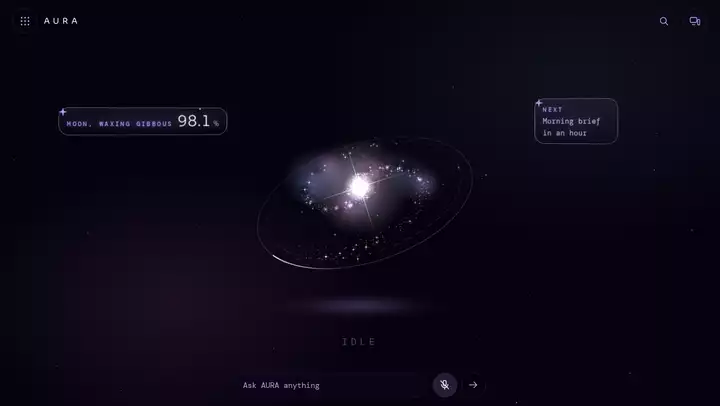
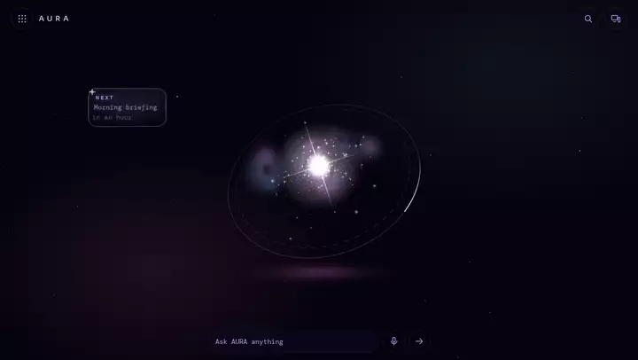
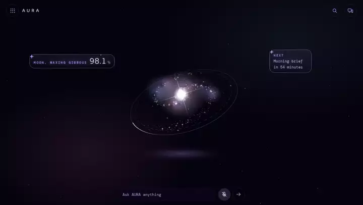
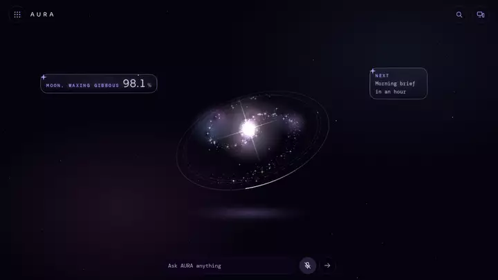
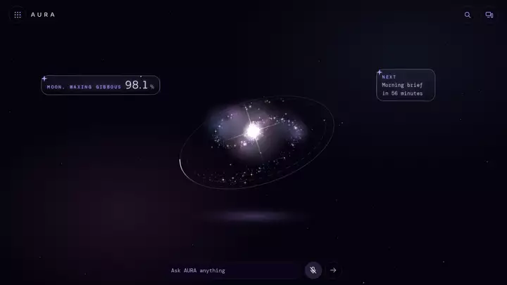
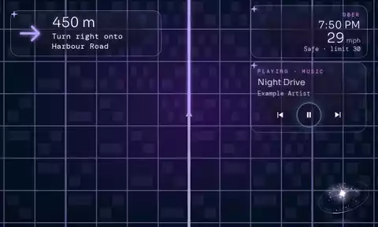
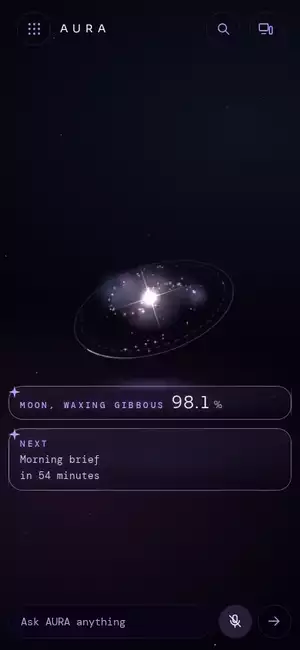
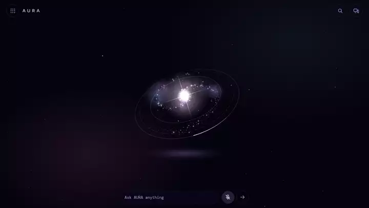
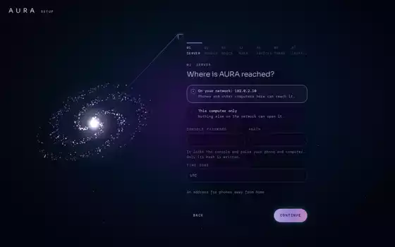
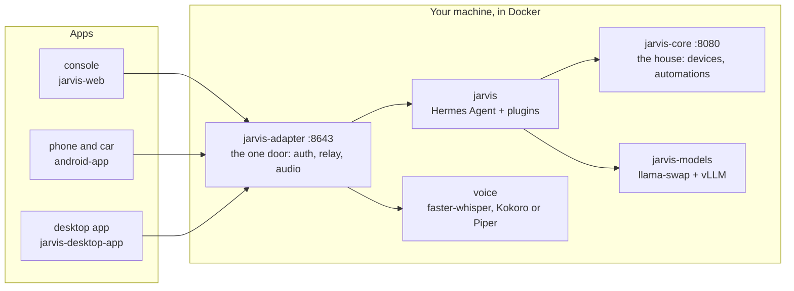

# AURA

AURA is a voice-first assistant for a home, run on your own machine: it listens, answers out
loud, draws what it found, runs the house and its machines, and asks before it does anything
that cannot be undone. Its other face is JARVIS: the same assistant with a second look, voice
and name.

```sh
curl -fsSL https://raw.githubusercontent.com/ChaseSunstrom/aura/main/install.sh | sh
```

Run it on a machine that has Docker. It opens a setup page in your browser and installs what
you answer; nothing is edited by hand. On Windows, in PowerShell: `irm https://raw.githubusercontent.com/ChaseSunstrom/aura/main/install.ps1 | iex`.
What it asks and what it needs: [Install](#install).

## The core

[](https://chasesunstrom.github.io/aura/media/core.mp4)

AURA is the core in the middle of the screen, and the core says what it is doing. It has nine
states: idle, listening, speaking, thinking, embedding (remembering), acting (a tool is
running), music, alert and working. Everything else on the screen is light the core projects,
and it goes back into the core when it is done with.

Each picture on this page is a short loop; it opens the whole film.

## Voice and the wake word

[](https://chasesunstrom.github.io/aura/media/voice.mp4)

Open the microphone and say "Aura". The wake word is scored on the device that hears it (the
console in a browser, the phone), so nothing is sent anywhere until it fires.
Speech becomes text with faster-whisper and the answer is spoken with Kokoro, both on your
machine; a lighter Piper voice is there for a machine with no graphics card. The house checks
who is speaking, and a guest's voice is allowed less than the owner's.

Limits, said plainly: the "Aura" wake word is trained and measured on synthetic speech, not
yet in a real room ([GAPS.md](GAPS.md), G35), and the server's own wake-word service, when you
switch it on at install, answers to "Hey Jarvis" in either theme.

## Answers you can see

[](https://chasesunstrom.github.io/aura/media/answer.mp4)

An answer is drawn as well as said. The steps show as they run (which tool, on what, how
long), and the result arrives as a projection beside the core: a timeline, a chart, a map, a
table, a comparison, code or a diff, a device, a person, what is playing. The same turn is
kept as a conversation you can open full screen.

## Approvals

[](https://chasesunstrom.github.io/aura/media/approval.mp4)

Every tool the model has is a row in one approval matrix: free, asked about, or denied to a
guest. A tool with no row is asked about every time. What cannot be undone is confirmed by
holding, not by a click, and the card says what will happen, lets you see it first, and takes
a rule for next time (ask every time, allow for this task, allow when I'm home).

## Two themes, switched live

[](https://chasesunstrom.github.io/aura/media/themes.mp4)

AURA and JARVIS are two personas: a look, a voice and a name. Switching changes the running
console in place, with no reload. Every colour, size and duration on every surface comes
from one file, [`design/tokens.json`](design/tokens.json).

## In the car

[](https://chasesunstrom.github.io/aura/media/car.mp4)

The Android app puts AURA on the car's screen through Android Auto: the next turn, speed
against the limit, what is playing, a call, and the same voice. With no signal the car still
says its fixed lines from clips kept on the phone.

## On the phone

[](https://chasesunstrom.github.io/aura/media/phone.mp4)

The Android app's home is this same console, with push-to-talk, the wake word, approvals and
a voice that works offline. Pairing is a QR: the console shows it under Settings > Pairing
and the app scans it ([pairing](docs/getting-started/pairing.md)).

## The house and its machines

[](https://chasesunstrom.github.io/aura/media/ops.mp4)

The house service ([`aura-core/`](aura-core/)) owns devices, automations and MQTT and speaks a
Home Assistant-shaped REST. The model reaches the rest through plugins
([`hermes/plugins/`](hermes/plugins/)): Proxmox, graphics-card telemetry, Grafana, n8n, mail,
calendar, contacts, texts and calls through the phone, Plex and Jellyfin, files, image
generation. The Board is what AURA did today, from its own records; Ops is the machines at a
glance.

## Install

[](https://chasesunstrom.github.io/aura/media/setup.mp4)

Linux and macOS:

```sh
curl -fsSL https://raw.githubusercontent.com/ChaseSunstrom/aura/main/install.sh | sh
```

Windows (PowerShell, with Docker Desktop and Git for Windows):

```powershell
irm https://raw.githubusercontent.com/ChaseSunstrom/aura/main/install.ps1 | iex
```

The line fetches the source into `~/aura/src` and opens a setup page on this computer only,
behind a one-time token. Six questions (server, models, voice, wake word, devices, theme), a
review, then the install with its progress on the same page.

It needs Docker with compose v2, curl, and 30 GB of free disk. An NVIDIA card and its
container toolkit are optional: with them the model and the natural voice run on this
machine; without them AURA runs on the processor and you give it a model endpoint you already
have.

What each step sets, the flags, and what the installer does not do (the firewall, HTTPS in
front of the console): [`docs/getting-started/install.md`](docs/getting-started/install.md).
The install is recorded on a clean Linux machine; macOS and Windows run the same script
through Docker Desktop and have not been run on real hardware by this project yet
([GAPS.md](GAPS.md), G44).

## How it is built

AURA is built on [Hermes Agent](https://github.com/NousResearch/hermes-agent): Hermes is the one agent loop, and this
repository is everything around it.



The apps talk to one origin, `jarvis-adapter`. It relays the session socket to Hermes, carries
audio to speech-to-text and back from text-to-speech, and proxies an OpenAI-shaped `/v1/chat/completions` for
scripts. Hermes runs the turn against the model (`jarvis-models` on this machine, or the
endpoint you gave) and reaches the house through `jarvis-core`. The wire contract between the
apps and the stack is [`docs/hermes-hud-protocol.md`](docs/hermes-hud-protocol.md).

| folder | what it is |
|---|---|
| [`hermes/`](hermes/) | what goes into the Hermes image: the persona seeds, the plugins, the skills |
| [`aura-adapter/`](aura-adapter/) | the one origin the apps talk to |
| [`aura-core/`](aura-core/) | the house service |
| [`jarvis-web/`](jarvis-web/) | the console (SvelteKit) |
| [`android-app/`](android-app/) | the phone and the car (Kotlin) |
| [`jarvis-desktop-app/`](jarvis-desktop-app/), [`aura-desktop/`](aura-desktop/) | the desktop app (Tauri, one file per platform) and the agent it carries |
| [`aura-schema/`](aura-schema/) | the one settings schema |
| [`aura-voice/`](aura-voice/) | the voice service |
| [`deploy/`](deploy/), [`scripts/`](scripts/) | the images, the compose files, the installer and its setup page |
| [`bench/`](bench/) | the capability benchmark |

Container, image and volume names keep the `jarvis-` prefix they were given before the project
was called AURA.

## Documentation

- [Getting started](docs/getting-started/README.md): install, first run, pairing.
- [The docs index](docs/README.md): how-to guides, the generated reference, explanation, the
  decisions (ADRs).
- [Runbooks](docs/runbooks/README.md): one per service, and
  [the host by hand](docs/runbooks/host.md) (bootstrap, rollback, key rotation).
- [CAPABILITIES.md](CAPABILITIES.md): every capability mapped to the benchmark task that
  proves it.

## What is proven

[`docs/verification.md`](docs/verification.md) is the claims register: each claim with the
command that demonstrates it. [GAPS.md](GAPS.md) is what has not been shown and why, and
[DEVIATIONS.md](DEVIATIONS.md) the judgement calls.

About the films on this page: they are the console's own build playing a scripted session
with a made-up house, filmed by `make readme-clips`, and they are silent. The state names
under the core in the first film are captions the film adds; the console does not print
them. The car film is the car screen's page with a stand-in for the phone beside it, the
phone film is the console at a phone's size, and the voice film's request is put in as text
where the microphone's would arrive. None of them shows a real household.

## Licence

AURA's own code is under the MIT License: [LICENSE](LICENSE).

The models and voices the house runs are not this project's and keep their own licences,
listed in [LICENSES.md](LICENSES.md). One of them, the phone's offline JARVIS voice, is for
your own devices only.
